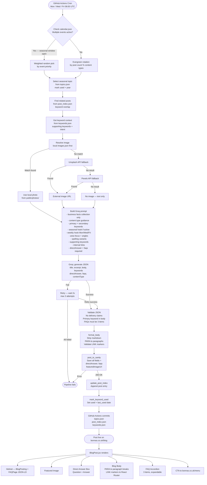

# 🍲 Bonna's — Authentic Bangladeshi Catering Website

A full-stack restaurant website for **Bonna's**, a home-based Bangladeshi catering service in London. Built with React + Vite + Tailwind CSS + DaisyUI, with Sanity CMS, Telegram ordering, and an automated SEO blog pipeline.

---

## 🌐 Live Site

[bonnas.co.uk](https://bonnas.co.uk)

---

##  Features

- **Dark Pink Brand Theme** — custom Tailwind palette built around the Bonna's logo (`#F2A8B5`)
- **Hero Carousel** — auto-rotating full-screen food photography with CTA
- **Online Ordering** — full cart system with Telegram bot notifications (no third-party payment needed)
- **Static Menu** — categorised menu with variant picker (e.g. Chicken / Lamb / Mixed)
- **Interactive Dark Map** — Leaflet + CartoDB dark tiles with pink-gold filter, user geolocation
- **Reservations Coming Soon** — email capture sends directly to Telegram
- **Automated SEO Blog** — GitHub Actions runs Mon/Wed/Fri, fetches trending UK food topics via RSS, generates original posts with Groq LLaMA, auto-publishes to Sanity CMS
- **Social Media Dashboard** — live YouTube stats + Facebook posts + live stream detection
- **Gallery with Lightbox** — masonry grid, tap to expand
- **React Router** — `/menu`, `/blog`, `/blog/:slug` as dedicated pages
- **Footer** — Halal badge, quick links, social icons, opening hours

---

---



---

---

## 🚀 Getting Started

### Prerequisites
- Node.js 18+
- Python 3.11+ (for blog pipeline)
- A Sanity account
- A Groq API key
- Telegram bot token

### Install

```bash
git clone https://github.com/farhanbin65/Bonnas-static-web.git
cd Bonnas-static-web
npm install
```

### Environment Variables

Create a `.env` file in the root:

```env
# Sanity
VITE_SANITY_PROJECT_ID=your_project_id
VITE_SANITY_DATASET=production

# Telegram
VITE_TELEGRAM_BOT_TOKEN=your_bot_token
VITE_TELEGRAM_CHAT_ID=your_chat_id
VITE_TELEGRAM_CHAT_ID_2=your_second_chat_id

# YouTube
VITE_YT_API_KEY=your_yt_key
VITE_YT_CHANNEL_ID=your_channel_id

# Facebook
VITE_FB_PAGE_ID=your_page_id
VITE_FB_ACCESS_TOKEN=your_fb_token
```

### Run Dev Server

```bash
npm run dev
```

### Build for Production

```bash
npm run build
```

---

## 🛒 Ordering System

Orders go through a Telegram bot — no payment gateway needed.

1. Customer browses `/menu`
2. Adds items to cart
3. Enters name + phone number
4. Clicks **Place Order**
5. Order is sent to two Telegram chats simultaneously
6. Minimum order: £20

To set up your own bot: message [@BotFather](https://t.me/BotFather) on Telegram.

---

## 📝 Automated Blog Pipeline

Runs automatically **Monday, Wednesday, Friday at 9am UTC** via GitHub Actions.

### How it works

```
GitHub Actions cron trigger
        ↓
Fetch RSS headlines from:
  - Google Trends (UK)
  - Reddit r/UKFood
  - BBC Food
        ↓
Send trending topics to Groq LLaMA 3.3 70B
Groq picks most relevant topic
Groq writes original 400-600 word blog post
connecting the trend to Bonna's
        ↓
Post saved to Sanity CMS via API
        ↓
Appears automatically on /blog
```

### Required GitHub Secrets

| Secret | Description |
|---|---|
| `GROQ_API_KEY` | From [console.groq.com](https://console.groq.com) |
| `VITE_SANITY_PROJECT_ID` | From Sanity dashboard |
| `VITE_SANITY_DATASET` | Usually `production` |
| `SANITY_WRITE_TOKEN` | Editor token from Sanity API settings |

### Run manually

Go to **GitHub → Actions → Blog Post Pipeline → Run workflow**

### Install Python dependencies locally

```bash
pip install feedparser groq requests
python scripts/generate_blog.py
```

---

## 🗺️ Map

Built with [Leaflet](https://leafletjs.com) + [CartoDB Dark Matter](https://carto.com/basemaps/) tiles.

- Custom CSS filter for pink-gold road glow matching the brand
- Pink 🍲 marker for Bonna's location (London E2)
- User geolocation — click "Show my location" to see both pins
- Map flies smoothly to show both locations

---

## 🎨 Design System

| Token | Value | Usage |
|---|---|---|
| `pink-bonnas` | `#F2A8B5` | Primary accent, CTAs, links |
| `pink-dark` | `#E8879A` | Hover states |
| `pink-light` | `#FDEEF1` | Subtle backgrounds |
| `night` | `#0D0A07` | Main background |
| `ember` | `#1E160D` | Card backgrounds |
| `cream` | `#F5ECD7` | Body text |
| `sand` | `#9D8E7A` | Muted text |
| `gold-dust` | `#3D2E1E` | Borders, dividers |

**Fonts:** DaisyUI `bonnas` theme via Tailwind CSS

---

## 🧱 Tech Stack

| Layer | Technology |
|---|---|
| Frontend | React 18, Vite, Tailwind CSS, DaisyUI |
| Routing | React Router v6 |
| CMS | Sanity v3 |
| Map | Leaflet, react-leaflet, CartoDB |
| AI | Groq LLaMA 3.3 70B |
| Automation | GitHub Actions (cron) |
| Notifications | Telegram Bot API |
| Social | YouTube Data API v3, Facebook Graph API |
| Deployment | Vercel / Netlify |

---

## 📦 Key Dependencies

```json
{
  "react": "^18",
  "react-router-dom": "^6",
  "@sanity/client": "latest",
  "leaflet": "latest",
  "react-leaflet": "latest",
  "react-icons": "latest"
}
```

---

## 🔒 Security Notes

- Never commit `.env` — it is in `.gitignore`
- Rotate all API keys if `.env` is ever accidentally pushed
- Sanity write token should be scoped to **Editor** only
- Telegram bot token gives full bot access — keep it private

---

## 📅 Roadmap

- [ ] Reservations system (form → Telegram confirmation)
- [ ] SEO blog auto-post to Facebook (Orchestrator Pulse integration)
- [ ] Sitemap.xml auto-generation
- [ ] Real food photography (replace Unsplash placeholders)
- [ ] WhatsApp order notifications
- [ ] Graduate Route visa sorted ✅

---

## 👨‍💻 Developer

**Farhan Bin Hossain**
- GitHub: [@farhanbin65](https://github.com/farhanbin65)
- Portfolio: [farhanbin.dev](https://farhanbin.dev)
- LinkedIn: [farhan-bin-1784541a0](https://linkedin.com/in/farhan-bin-1784541a0)

---

## 📄 License

Private project — all rights reserved. Built for Bonna's catering service, London.

---

*Built with ❤️ and barakah in London*